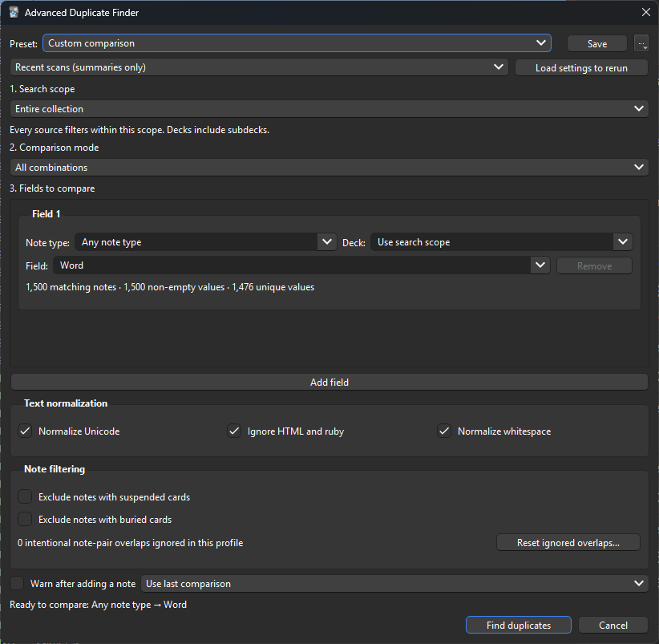
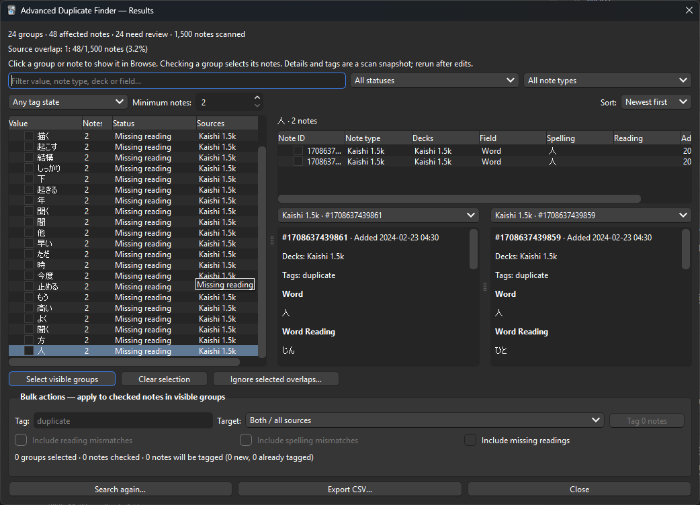

# Advanced Duplicate Finder

Compare note fields across Anki decks and note types, inspect matches side by
side, and tag the notes you choose.

<table>
  <tr>
    <td width="50%">
      
    </td>
    <td width="50%">
      
    </td>
  </tr>
  <tr>
    <td align="center">Search settings</td>
    <td align="center">Duplicate results</td>
  </tr>
</table>

Scans are read-only. Tagging is optional and supports Anki's Undo.

## Install and open

If installing from source, copy the project into
`addons21/anki-adf/`, with `__init__.py` directly inside that
folder. You can locate add-on folders through **Tools → Add-ons → View Files**.
Restart Anki after installing or updating.

Open **Browse → Notes → Advanced Duplicate Finder**, or choose **Advanced
Duplicate Finder** from the main **Tools** menu. Both open the finder attached
to Browse.

## Run your first search

A fresh setup starts with **All combinations** and **one field row**.

1. Choose a **search scope**.
2. Choose a **comparison mode**.
3. For each source, choose a **note type**, an optional **deck**, and a **field**.
4. Click **Find duplicates**.

Field dropdowns support typing and suggestions. Each source shows matching note,
non-empty value and unique value counts. Hover over the counts for sample values.

### Search scope

| Scope | What it compares |
| --- | --- |
| Entire collection | Notes from the whole collection. |
| Selected decks | Notes from any checked deck, including subdecks. |
| Selected notes — compare with each other | Only notes selected in Browse. |
| Selected notes — compare against collection | Selected notes against existing notes, including matches within the selection. |

**Source filters narrow the global scope.** A note must satisfy both. Multiple
cards from the same note count as one note.

### Comparison mode

| Mode | Behavior |
| --- | --- |
| All combinations | Compare every chosen source, including duplicates within one source. Use **Add field** for more sources. |
| Two fields | Compare **Source A** against **Source B**, using exactly two rows. |

Sources can use the same field name. Empty values are ignored, and a note is
never compared with itself.

### Example: selected Kiku notes against Kaishi

| Setting | Choose |
| --- | --- |
| Scope | Selected notes — compare against collection |
| Mode | Two fields |
| Source A | Kiku → Expression |
| Source B | Kaishi → Word |

Optionally choose a deck for each source. The selected Kiku notes must pass
Source A's filters to participate.

## Read the results

A **group** contains notes sharing one matching value. For example, a Kiku note
and a Kaishi note containing `食べる` form one group with two notes.

- **Click a group** to show its notes in Browse and fill the inspector.
- **Click a note row** to show that individual note in Browse.
- Use the two detail panes to compare readings, definitions, sentences and other
  fields. Their dropdowns let you choose any two notes from the group.
- Use filters or sorting to narrow the results. **Minimum notes: 3**, for example,
  hides groups containing only two notes.
- **Search again…** closes the old results and reopens their search settings.
  Cancel leaves the old results closed.

Results are a snapshot. Search again after editing notes. Window sizes and pane
proportions are remembered.

### Match statuses

| Status | Meaning |
| --- | --- |
| Exact text match | The raw field text is identical; meaning is not verified. |
| Normalized match | Different raw text becomes equal after normalization. |
| Reading mismatch | Equal expressions have different known readings. |
| Spelling mismatch | Equal readings have different known spellings. |
| Missing reading | A reading is missing from either expression note. |

Japanese spelling/reading checks recognize `Expression`, `ExpressionReading`,
`Word` and `WordReading`. Other field names receive text comparisons. Reading or
spelling mismatches take priority over formatting differences.

## Select and tag notes

1. Check a group to select all its notes, or check individual notes in the note
   table. **Select visible groups** checks all currently displayed groups.
2. Enter a tag, or leave the field empty to use **`duplicate`**. The dimmed
   placeholder shows this default.
3. Choose a **Target**: all sources or a particular source.
4. Enable any review categories you want to include, then click **Tag N notes**.

Reading mismatches, spelling mismatches and missing readings are excluded from
tagging unless explicitly included. Unavailable inclusion options are disabled.

The summary shows checked notes, eligible targets, and new/already-tagged counts.
Confirmation rereads current tags. Existing tags are preserved; the same tag is
not added twice. Tags apply to the whole note and all its cards.

**Only checked notes in visible groups qualify.** Status and note-type filters
also restrict eligible pairs. Tag-state filters use the tag entered above and
restrict eligible notes while retaining groups for context.

### Ignore intentional overlaps

Use **Ignore selected overlaps…** when you deliberately want to keep two notes
with the same value. Check both notes, or their whole group, before clicking it.

The add-on remembers the note pair for the current profile and suppresses that
pair across all shared values in future scans. Other pairs with the same value
can still appear. Notes and tags remain unchanged.

Use **Reset ignored overlaps…** in the setup window to clear the profile's list.

### Export CSV

**Export CSV…** saves all non-ignored pair comparisons, regardless of filters or
checks. A ten-note group can produce 45 CSV rows. Export confirmation appears
inside the results window.

Source overlap statistics show matched/scanned note counts and percentages for
each source.

## Save and repeat searches

- **Save** updates the selected preset, or names a new one for a custom search.
- The **⋯** menu offers Save as new, Update, Rename, Delete and Set as default.
- **Modified** marks unsaved changes to a preset.
- Reopening uses the default preset, if set; otherwise it restores the last setup.
- **Recent scans** keeps up to 20 distinct comparisons for the current profile.
  Repeating one updates its summary and moves it to the top.
- **Load settings to rerun** restores settings, not old results. Selected-note
  searches use the current Browser selection. Different selections have separate
  history entries.

## Matching options

**Text normalization** options are independent and enabled by default:

| Option | Behavior |
| --- | --- |
| Normalize Unicode | Uses NFC and removes zero-width spaces/BOM. Does not perform NFKC compatibility folding. |
| Ignore HTML and ruby | Compares visible text, ignoring markup, ruby readings, scripts and styles. |
| Normalize whitespace | Trims outer whitespace and collapses internal whitespace to one space. |

**Note filtering** has separate options for suspended and buried cards. Each
excludes the entire note if **any** sibling card meets the condition, even when
another sibling is active.

## Automatic checks while adding notes

Enable **Warn after adding a note** and choose a saved preset or **Use last
comparison**. New notes saved through Anki's Add window are checked against that
configuration. If matches are found, the results open and identify the preset.

The check runs **after saving** and does not prevent adding. The new note must
pass the configured source filters. Imports and external APIs do not trigger it.

The first check builds a value index; later additions check relevant matches.
Collection changes invalidate the cache. Large duplicate groups can still be
expensive during full scans because they generate many note pairs. Scans run in
the background and support cancellation; an active backend query finishes first.

## Reset the add-on

Settings, presets, history, ignored pairs and window sizes are stored in the
`"config"` property of **`meta.json`**.

1. Locate the add-on using **Tools → Add-ons → View Files**.
2. Close Anki completely and back up `meta.json`.
3. Remove its entire `"config"` property, keeping the other properties and valid JSON.
4. Reopen Anki.

This resets the add-on's local state. Notes and tags already applied are unchanged.
`config.json` contains shared defaults; it is not the file to clear.

## Development and testing

Run the portable regression suite from the add-on folder:

```powershell
python -B -m unittest discover -s . -v
```

See [Local QA](.qa/README.md) for Qt interaction checks and tests using a fresh
synthetic Anki collection. These checks do not open the user's collection.

Keep `config.json`, `manifest.json`, runtime modules and test sources in version
control. `.gitignore` excludes personal Anki state, Python caches, local reports,
packages and generated QA outputs. It keeps the `.qa` scripts and documentation.

## License

GNU Affero General Public License v3.0. See [LICENSE](LICENSE).
